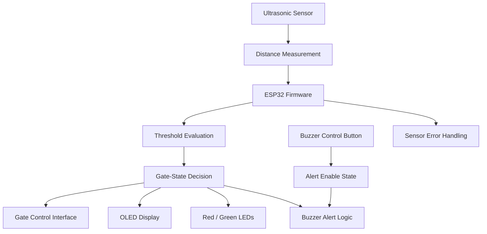
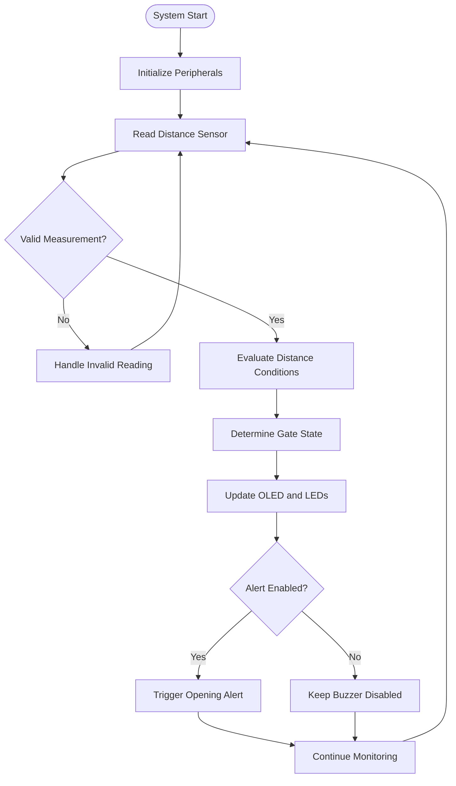

<div align="center">

# GateX

### SMART GATE AUTOMATION · EMBEDDED SYSTEMS

**Sense. Decide. Respond.**

An ESP32-based gate automation prototype integrating ultrasonic distance sensing, OLED visual feedback, status indicators, and independent buzzer control.

<br/>


[Overview](#overview) · [Architecture](#system-architecture) · [Hardware](#hardware-design) · [Firmware](#firmware-logic) · [Testing](#validation-and-testing) · [Roadmap](#engineering-roadmap)

</div>

---

## 01 · Overview

**GateX is a microcontroller-based automation project that translates distance measurements into gate-state decisions and clear user feedback.**

Built around the ESP32, the system combines ultrasonic sensing, embedded control logic, an OLED interface, LED indicators, and a user-controlled audible alert.

Instead of treating these components as independent circuits, GateX brings them together into a coordinated embedded application.

The design focuses on three engineering objectives:

- **Automation:** Use sensor measurements and configured thresholds to determine the required gate state.
- **Observability:** Communicate the current state through an OLED display and dedicated LED indicators.
- **User control:** Allow the buzzer to be disabled without intentionally interrupting the main monitoring and display functions.

The result is a practical foundation for exploring sensor-driven automation, firmware architecture, and human-machine interaction.

> **Project classification:** Embedded automation prototype. Production deployment requires appropriate actuator integration, obstruction protection, fault handling, and hardware validation.

## 02 · Project at a Glance

| Attribute | Details |
|---|---|
| Project name | GateX |
| Primary controller | ESP32 |
| Sensing | Ultrasonic distance measurement |
| User interface | 0.96-inch OLED display |
| Visual indicators | Red and green LEDs |
| Audible feedback | Buzzer with approximately 5-second alert |
| User input | Buzzer control button |
| Programming | Embedded C/C++ |
| Application domain | Smart automation and embedded control |
| Development stage | Prototype |

## 03 · Engineering Highlights

<details>
<summary><strong>Sensor-driven control</strong></summary>

The ultrasonic sensor provides distance measurements. The firmware evaluates these measurements against configured conditions to determine the required gate state.

</details>

<details>
<summary><strong>State-oriented visual feedback</strong></summary>

The OLED uses expressive visual states to make the system easier to understand:

- Happy expression: gate-open state.
- Sad expression: gate-closed state.

Red and green LEDs provide additional status indication.

</details>

<details>
<summary><strong>Independent audible-alert control</strong></summary>

A dedicated button controls whether the buzzer is enabled. The intended behavior is to preserve distance monitoring, gate automation, and visual feedback when the audible alert is disabled.

</details>

<details>
<summary><strong>Integrated embedded hardware</strong></summary>

The project combines digital input handling, sensor interfacing, display rendering, GPIO output control, and event-driven feedback within a single microcontroller-based system.

</details>

---

## 04 · System Architecture

GateX follows a sensor-controller-interface architecture.



**Architecture note:** The diagram describes the intended functional design. The final gate-control interface and error-handling behavior must match the implemented firmware and hardware.

### Functional responsibilities

| Subsystem | Responsibility |
|---|---|
| Sensing layer | Obtain distance measurements |
| Control layer | Evaluate configured conditions and determine gate state |
| Display layer | Render OLED expressions and status |
| Indicator layer | Represent gate state using LEDs |
| Alert layer | Manage buzzer activation and mute behavior |
| Input layer | Read the buzzer-control button |

This separation makes the design easier to debug, extend, and maintain.

---

## 05 · Hardware Design

### Core components

| Component | Engineering role |
|---|---|
| ESP32 development board | Processing, decision logic, and peripheral control |
| Ultrasonic sensor | Non-contact distance measurement |
| 0.96-inch OLED | Compact visual interface |
| Buzzer | Audible event notification |
| Push button | User control for the buzzer |
| Red LED | Open-state indication |
| Green LED | Closed-state indication |
| Power and interconnects | Supply and signal connections |

### Signal flow

```text
Distance Sensor
      |
      | Distance data
      v
ESP32 Processing
      |
      +---- OLED status
      |
      +---- LED indicators
      |
      +---- Buzzer control
      |
      +---- Gate-control interface*
      
*Depends on the actual actuator and driver implementation.
```

### Wiring documentation

The final repository should include a verified pin-assignment table.

| Signal | GPIO assignment |
|---|---|
| Ultrasonic trigger | Add verified GPIO |
| Ultrasonic echo | Add verified GPIO |
| OLED SDA | Add verified GPIO |
| OLED SCL | Add verified GPIO |
| Buzzer control | Add verified GPIO |
| Buzzer button | Add verified GPIO |
| Red LED | Add verified GPIO |
| Green LED | Add verified GPIO |

**Do not copy example pin assignments without checking the actual circuit and firmware.**

### Electrical design considerations

- ESP32 GPIOs use 3.3 V logic; verify sensor output levels before connecting them.
- If the ultrasonic sensor has a 5 V echo output, use an appropriate level shifter or voltage divider.
- Use suitable current-limiting resistors for LEDs.
- Confirm the voltage and current requirements of the OLED and buzzer.
- Any physical gate actuator must use an appropriate driver and independent power design.

---

## 06 · Firmware Logic

The firmware should coordinate sensing, state transitions, display updates, and alert behavior.

### Control sequence



This flowchart represents the intended control strategy. The actual implementation should be checked against the source code, especially the invalid-reading branch and alert timing.

### State-management considerations

A robust implementation should distinguish between:

- Current measured distance.
- Requested gate state.
- Previous gate state.
- Buzzer-enable setting.
- Current alert timing.
- Sensor validity.

Keeping these states separate helps prevent repeated alerts, unnecessary gate-state transitions, and display inconsistencies.

### Threshold stability

Ultrasonic readings may fluctuate near a configured boundary. Hysteresis, filtering, or a suitable state-transition policy can reduce repeated switching.

For example, the opening and closing thresholds can be configured separately rather than using a single threshold for both transitions.

Actual values should be selected and tested for the installation rather than assumed.

---

## 07 · User Interface and Feedback

GateX uses multiple feedback channels to communicate its operating state.

| Output | Intended behavior |
|---|---|
| OLED happy expression | Gate open |
| OLED sad expression | Gate closed |
| Red LED | Gate open |
| Green LED | Gate closed |
| Buzzer | Approximately five-second alert on opening |
| Control button | Enables or disables audible alerts |

The visual indicators should reflect the controller's actual state. If the hardware does not independently confirm the physical gate position, the display should not be described as verified position feedback.

### Hardware gallery

Replace these placeholders with real photographs from your project.

| Asset | Recommended content |
|---|---|
| Main assembly | ESP32, sensor, display, and wiring |
| OLED interface | Happy and sad display states |
| Control hardware | Button, LEDs, and buzzer |
| Wiring view | Clear component and pin connections |

Suggested filenames:

```text
images/gatex-overview.jpg
images/gatex-open-state.jpg
images/gatex-closed-state.jpg
images/gatex-wiring.jpg
```

Once the images exist, embed them using standard Markdown:

```markdown

```

Use actual project photographs rather than stock images or AI-generated hardware photos presented as the real prototype.

---

## 08 · Validation and Testing

A professional embedded project should document observed behavior, not just intended functionality.

| Test case | Expected result | Status |
|---|---|---|
| Object enters configured opening range | Open-state decision is triggered | To verify |
| Distance satisfies closing condition | Closed-state decision is triggered | To verify |
| Open state is selected | OLED and red LED update | To verify |
| Closed state is selected | OLED and green LED update | To verify |
| Opening alert is enabled | Buzzer operates for the configured duration | To verify |
| Buzzer is disabled | Audible alert remains suppressed | To verify |
| Buzzer is disabled | Monitoring and visual feedback continue | To verify |
| Sensor returns an invalid reading | Firmware handles the fault safely | To verify |
| Power is interrupted and restored | Startup and state recovery are checked | To verify |

Update each status only after testing the real hardware. Add a short observation or test result when a case passes.

---

## 09 · Software and Development Environment

The exact dependency list should reflect the firmware in the repository.

| Tool or technology | Purpose |
|---|---|
| Embedded C/C++ | Control logic and peripheral integration |
| ESP32 Arduino core, if used | Board support and peripheral APIs |
| Arduino IDE or PlatformIO | Firmware development and upload |
| OLED display library | Text, graphics, and expressions |
| Git | Source-code version control |
| GitHub | Project documentation and collaboration |

### Build and upload

1. Clone the repository.
2. Open the project in its supported development environment.
3. Install the required ESP32 board package and firmware libraries.
4. Configure the actual GPIO assignments.
5. Connect the circuit according to the wiring documentation.
6. Compile the firmware and resolve build errors.
7. Upload it to the ESP32.
8. Test the sensor, display, LEDs, button, and buzzer independently.
9. Run integrated tests and document the results.

Include exact build commands, dependency versions, and upload settings after confirming the project's actual environment.

---

## 10 · Reliability and Safety

GateX is a learning and prototyping project, not a certified safety-rated gate controller.

For a real motorized gate, the design must account for:

- Physical obstruction and pinch-point hazards.
- Independent safety sensors and suitable limit switches.
- Appropriate motor drivers and power protection.
- Sensor timeout and controller-reset behavior.
- Unexpected distance readings and environmental interference.
- Safe behavior following communication, power, or hardware failures.

An ultrasonic sensor alone is not sufficient to guarantee that a gate can operate safely around people.

Testing should initially be performed with the actuator disconnected or the mechanism safely isolated. Production use requires a proper mechanical and electrical safety design.

---

## 11 · Engineering Roadmap

Potential development stages:

- [ ] Publish verified firmware and a complete wiring diagram.
- [ ] Add real hardware photographs and a demonstration video.
- [ ] Implement and test sensor timeout handling.
- [ ] Improve distance filtering and threshold hysteresis.
- [ ] Verify non-blocking buzzer timing.
- [ ] Add physical gate-position feedback where applicable.
- [ ] Implement appropriate obstruction detection and actuator safety.
- [ ] Add optional local Wi-Fi monitoring and event logging.
- [ ] Document repeatable integration tests.

These items are proposed improvements, not a list of features already implemented.

---

## 12 · Skills Demonstrated

GateX provides practical exposure to:

- ESP32 firmware development.
- Ultrasonic sensor interfacing.
- GPIO input and output control.
- OLED display programming.
- Embedded state management.
- Audible and visual feedback.
- Hardware integration and troubleshooting.
- Functional validation and technical documentation.

These are the engineering areas demonstrated by the project; their depth should be supported by the published firmware, circuit documentation, and test evidence.

---

## 13 · Author

**Manish Pal**  
Aspiring Embedded Systems Engineer

- GitHub: [@Mr-Manish-Pal](https://github.com/Mr-Manish-Pal)
- LinkedIn: [Manish Pal](https://www.linkedin.com/in/manish-pal-b34928438/)

---

## License

No license has been specified in this documentation. Add a `LICENSE` file after selecting the terms for reuse, modification, and distribution.

<div align="center">

**GateX — A Practical Study in Embedded Automation**

*From sensor measurements to coordinated system feedback.*

</div>
